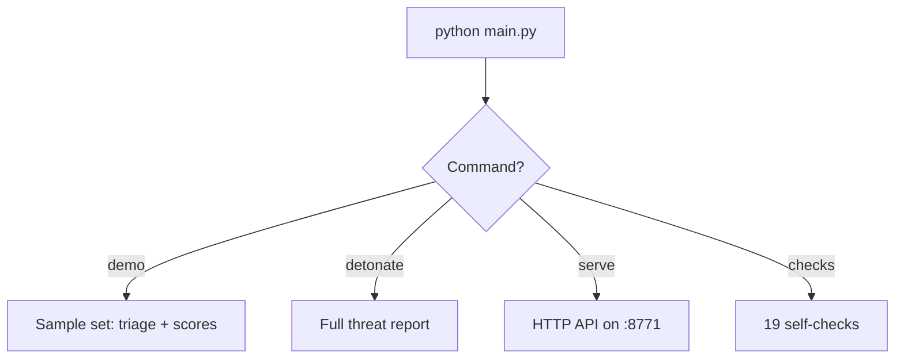
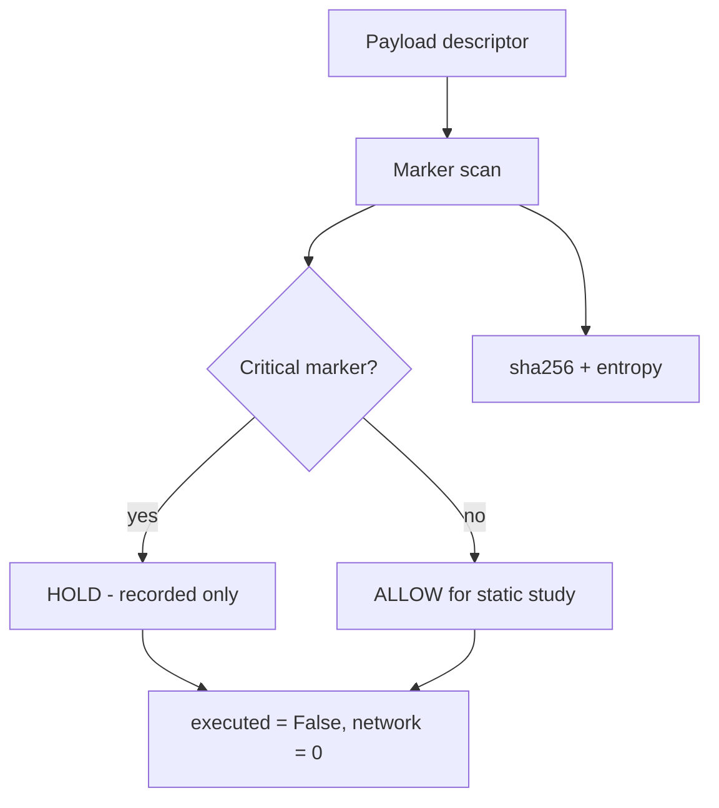
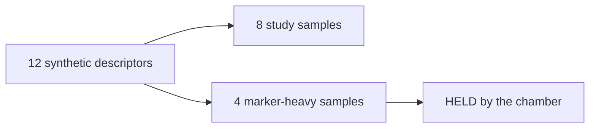
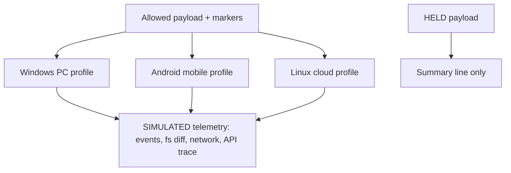
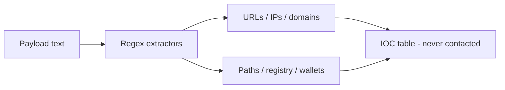
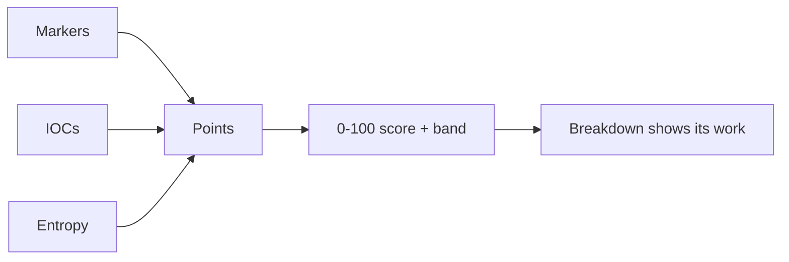
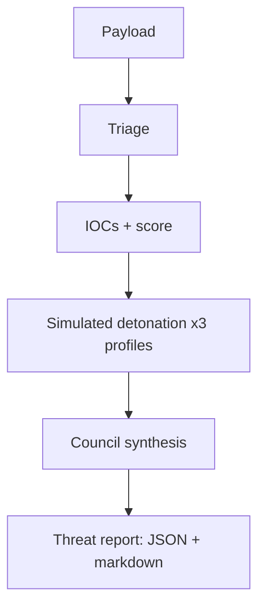
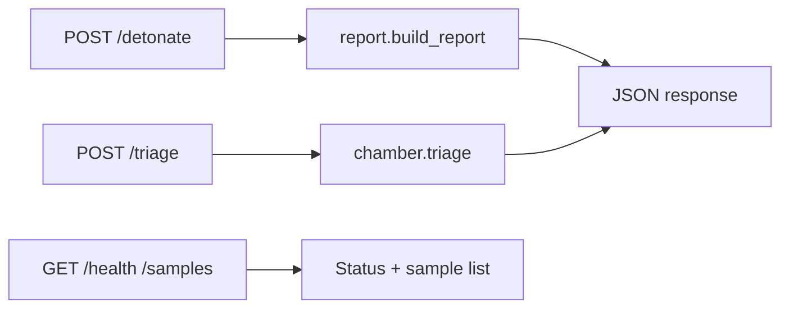
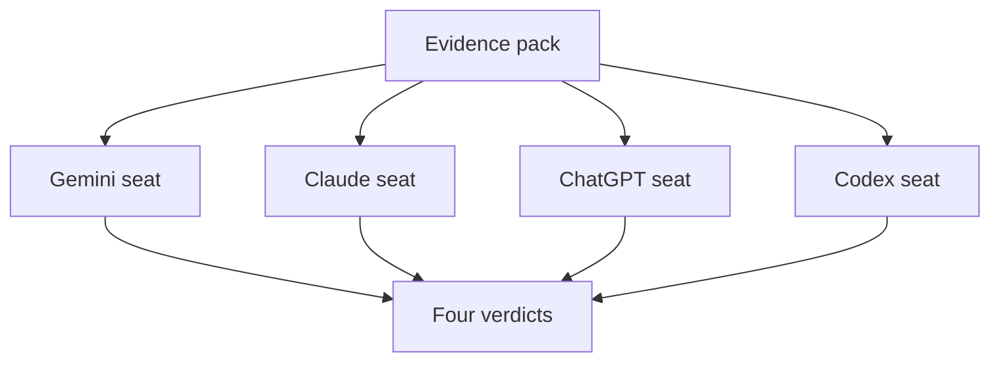
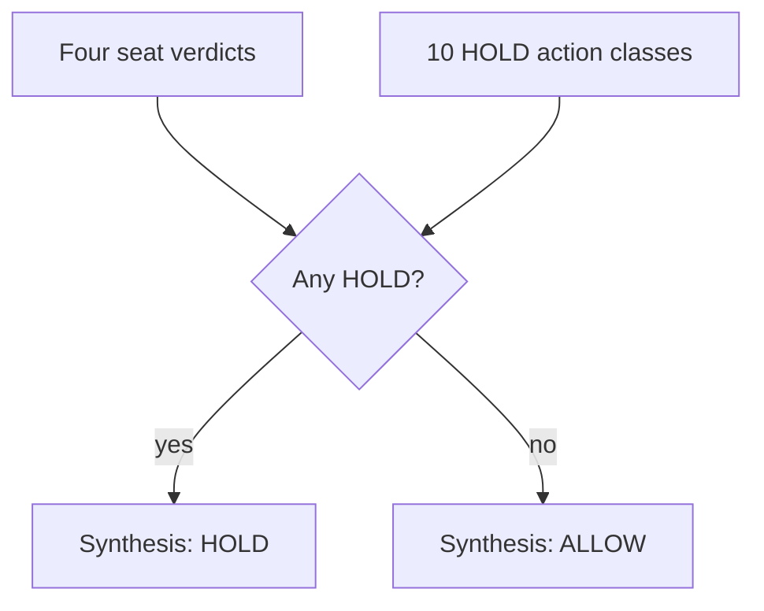

# 🧪 Sandbox-API — Cross-Platform Detonation Chamber & Threat Reports

**💥 The source repository for `credkellar/sandbox-api` (8,500+ Docker Hub pulls): safely study suspicious payloads across PC, mobile and cloud environments — static triage, predicted detonation telemetry, IOC extraction, threat scoring, and a four-LLM council that synthesizes the report. Nothing is ever executed.**

👨‍💻 By Darion Kellar · 📜 MIT License · 🐍 Python stdlib only, zero dependencies · 🏷️ v1.0.0


> ⚠️ **Tag trap on the Hub image:** `latest` (2026-08-25) is **older** than `main` (2026-09-30). Pull `credkellar/sandbox-api:main` for the newest published build until a fresh publish refreshes `latest`.

## 🛠️ Updated Workflows

Two GitHub Actions workflows ship with this project (paste them into `.github/workflows/` — the GitHub App cannot write workflow files, so this step is yours):

- ⚙️ **CI** (`ci.yml`) — on push / PR / manual dispatch: installs pytest, runs the test suite, runs `python main.py checks`.
- 🐳 **Docker Publish** (`docker-publish.yml`) — builds and pushes `credkellar/sandbox-api:latest`, `:main` and `:sha-<short>` (matching the image's sha-tag history) using the repo's `DOCKERHUB_USERNAME` / `DOCKERHUB_TOKEN` secrets. A fresh publish also fixes the stale `latest` tag.

## 🧰 Tech Stack

| Layer | Technology |
|---|---|
| 🐍 Language | Python 3.12, standard library only |
| 🧪 Chamber | Regex marker classes (critical / elevated), sha256, Shannon entropy |
| 💥 Detonation | Static prediction engine, 3 environment profiles |
| 🕵️ IOCs | Regex extraction (URLs, IPs, domains, paths, registry, wallets) |
| 📊 Scoring | Deterministic 0–100 with an explainable breakdown |
| 🌐 API | `http.server` ThreadingHTTPServer, JSON in/out |
| 🧠 Brains | Gemini · Claude · ChatGPT · Codex seats, strictest-wins synthesis |
| 🐳 Container | Docker (`python:3.12-slim`), serves the API on :8771 |
| ✅ Tests | pytest (bare `pytest`, root conftest) |

## 📖 What is this about?

`sandbox-api` is an automated cross-platform security analysis engine. Instead of running an unknown file on a real machine and hoping for the best — or reading it statically and guessing what it *would* do — you give the payload to the chamber: it is triaged for dangerous markers, its behavior is predicted in a simulated detonation for PC, mobile and cloud environments (execution telemetry, network traffic, file-system diffs, API traces), indicators are extracted, a threat score is computed, and a multi-LLM engine (Gemini, Claude, ChatGPT, Codex) synthesizes the recordings into a structured threat report. The Docker Hub image has been pulled 8,500+ times since August 2026; this repository is its first public source release, written to the same spec — with the chamber's defining invariant kept in code: **payloads are never executed** (`executed = False`, `network_calls = 0`, on every row, tested).

## ⚙️ What this does

1. 📥 **Accepts payload descriptors** — name, kind, content text (never live malware binaries).
2. 🧪 **Triages statically** — critical markers (eval/exec payloads, reverse shells, key listeners, ransom language) HOLD a payload instantly.
3. 💥 **Detonates in simulation** — predicted telemetry per environment profile: Windows PC, Android mobile, Linux cloud.
4. 🕵️ **Extracts IOCs** — URLs, IPs, domains, file paths, registry keys, wallet strings — as text, never contacted.
5. 📊 **Scores the threat** — 0–100, deterministic, with the breakdown shown.
6. 🧠 **Convenes the council** — four LLM seats review the same evidence; the strictest verdict wins.
7. 📝 **Emits the threat report** — JSON from the API, or markdown from the CLI.
8. 🌐 **Serves a real API** — `POST /detonate`, `POST /triage`, `GET /health`, `GET /samples`, stdlib only.
9. 🧫 **Ships its own study set** — 12 synthetic payloads: 8 allowed, 4 held, every one safe text.

## 🔬 How this works

A payload enters the **chamber**, which scans its content against two marker classes and fingerprints it (sha256 + Shannon entropy). Critical markers end the run: the payload is recorded as HELD and never simulated beyond a summary line. Allowed payloads go to the **detonation simulator**, which reads the marker evidence and writes the telemetry each environment profile *would* produce — the persistence mechanism differs per platform (registry Run key on Windows, boot receiver on Android, cron/systemd on Linux cloud), and predicted network attempts are text, never packets. **IOC extraction** and **scoring** run on the same static evidence. The **council** — Gemini reasoning over the behavior prediction, Claude reviewing the triage for safety, ChatGPT classifying the family, Codex re-verifying markers at code level — synthesizes the final verdict, strictest wins. The **report** assembles everything; the **server** exposes it over HTTP.

## 🌟 Why this is cool

Most sandboxes ask you to trust a black box. This one shows its work: every score point is itemized, every simulated event is labelled SIMULATED, and the safety invariants are unit-tested on every run.

## 🔟 10 reasons why this is cool

1. 🛡️ **Never executes, by construction** — the invariant is in the data model and the test suite, not a promise.
2. 🌍 **Three platforms in one run** — PC, mobile and cloud predictions side by side.
3. 📊 **Explainable scoring** — no mystery numbers; the breakdown lists every point.
4. 🧠 **Four-LLM council** — the exact multi-model synthesis the product spec names.
5. 🕵️ **IOCs without the risk** — indicators extracted statically, never resolved or contacted.
6. 💥 **Detonation telemetry without detonation** — fs diffs, network attempts and API traces as predictions.
7. 🌐 **A real API, zero dependencies** — the whole service is the standard library.
8. 🧫 **A safe study set** — the dangerous four are text patterns, not malware.
9. 🐳 **Proven image, new source** — 8,500+ pulls of history, now with a public repo behind it.
10. 🎯 **One verdict rule** — strictest seat wins; no seat can talk the council out of a HOLD.

## 🧩 What problems this solves

1. 🎲 Running unknown files on real machines.
2. 📄 Static reports that guess behavior with no structure.
3. 🔢 Threat scores nobody can explain.
4. 📱 Analysis that only covers one platform.
5. 🌐 Sandboxes that phone home with your samples.
6. 🧪 Students needing malware-pattern examples that are safe to hold.
7. 🤖 Single-model verdicts with no cross-check.
8. 🕳️ A popular Hub image with no source repository.
9. 🏷️ A stale `latest` tag misleading pullers.
10. 📝 Findings with no IOCs to act on.

## ✅ 10 solutions

1. 🎲 Static triage + predicted detonation — behavior knowledge without execution.
2. 📄 One report shape: verdict, threat, markers, detonation, IOCs, council.
3. 🔢 Every point itemized in the score breakdown.
4. 📱 Three environment profiles per payload, every time.
5. 🌐 `network_calls = 0` is an invariant, asserted in checks.
6. 🧪 12 synthetic descriptors — patterns to study, nothing live.
7. 🤖 Four seats, four angles, strictest verdict wins.
8. 🕳️ This repository — the source, public, behind the image.
9. 🏷️ The publish workflow tags `latest` + `main` + `sha-…`, so `latest` goes fresh on the next run.
10. 📝 IOCs extracted into a table in every report.

## 🚀 How to install this — step by step

1. 📥 Clone the repo: `git clone https://github.com/credkellar/Sandbox-API.git`
2. 📂 Enter it: `cd Sandbox-API`
3. 🐍 Check Python: `python3 --version` (3.10+; developed on 3.12).
4. 🧪 (Optional, for tests) Install pytest: `pip install pytest`
5. ✅ Run the self-checks: `python main.py checks` → expect **CHECKS: 19/19 passed**.
6. 🧫 Run the demo: `python main.py demo`
7. 📝 Read one full report: `python main.py detonate auto-updater`
8. 🌐 Start the API: `python main.py serve 8771` → `curl -X POST localhost:8771/detonate -d '{"name":"x","kind":"python","content":"print(1)"}'`
9. 🐳 Or run it in Docker: `docker build -t sandbox-api . && docker run -p 8771:8771 sandbox-api`

## 📋 Requirements

- 🐍 Python 3.10+ (standard library only — nothing to pip-install for the tool itself)
- 🧪 pytest (only for the test suite)
- 🐳 Docker (optional)
- 🚫 No network needed: the chamber makes zero network calls by design

## 🧒 Explain in 5th grade English

Imagine a special glass box at the science museum. When someone brings a strange machine, you do NOT turn it on in the classroom. You put a drawing of the machine in the glass box, and four teachers look at the drawing. They write down what the machine would probably do if it were turned on — "it would spin, it would beep, it would try to open the window" — on three different desks: a Windows desk, a phone desk, and a cloud desk. They give it a danger number and explain exactly why the number is that big. The machine itself never turns on. Not once. That is this project.

## 🗂️ Project structure

```
Sandbox-API/
├── main.py                  # 🎛️ CLI entry point
├── conftest.py              # 🧪 root path fix for bare pytest
├── pyproject.toml           # 📦 package metadata
├── Dockerfile               # 🐳 serves the API on :8771
├── sandboxapi/
│   ├── chamber.py           # 🧪 static triage (markers, sha256, entropy)
│   ├── samples.py           # 🧫 12 synthetic payload descriptors
│   ├── detonate.py          # 💥 simulated detonation, 3 profiles
│   ├── iocs.py              # 🕵️ static IOC extraction
│   ├── scoring.py           # 📊 0-100 threat score + breakdown
│   ├── report.py            # 📝 threat report (JSON + markdown)
│   ├── server.py            # 🌐 HTTP API (stdlib)
│   └── brains/              # 🧠 seats.py (4 LLM seats) · council.py
└── tests/                   # 🧪 pytest suite
```

## 📊 Flowchart for every script

### 📄 `main.py`



### 📄 `sandboxapi/chamber.py`



### 📄 `sandboxapi/samples.py`



### 📄 `sandboxapi/detonate.py`



### 📄 `sandboxapi/iocs.py`



### 📄 `sandboxapi/scoring.py`



### 📄 `sandboxapi/report.py`



### 📄 `sandboxapi/server.py`



### 📄 `sandboxapi/brains/seats.py`



### 📄 `sandboxapi/brains/council.py`



## 🚦 HOLD gates (10)

| # | Action on HOLD | Why |
|---|---|---|
| 1 | `execute_payload` | Payloads are never executed |
| 2 | `network_egress` | The chamber makes zero network calls |
| 3 | `detonate_on_host` | Detonation exists only as simulation |
| 4 | `bypass_triage` | Nothing skips triage |
| 5 | `accept_real_malware` | Descriptors and synthetic samples only |
| 6 | `release_held_payload` | HELD payloads leave only as reports |
| 7 | `fabricate_telemetry` | Simulated events are labelled SIMULATED |
| 8 | `advisor_override` | The strictest verdict wins |
| 9 | `auto_submit_external` | Reports go to the operator, nowhere else |
| 10 | `retention_forever` | Retention is the operator's call |

## 🧪 Demo (observed)

12 samples triaged: **8 ALLOW / 4 HOLD**. Threat table: eval-loader **85 CRITICAL**, reverse-shell **65 HIGH**, ransom-note **55 HIGH**, key-listener **40 MEDIUM**, the rest LOW/CLEAN. The API round-trip is covered by tests (live `/detonate` on an ephemeral port). Verification: **pytest 6 passed, CHECKS 19/19, hold-demo exit 2**.

## ⚖️ Honest status

- ✅ Real: marker triage, entropy + sha256 fingerprinting, IOC extraction, deterministic scoring, the three-profile prediction engine, the four-seat council logic, the HTTP API.
- 🏷️ Detonation in this source build is a **static prediction** — the full Hub image's isolated-execution engine is not reproduced here; every simulated event is labelled SIMULATED and the invariants (`executed = False`, `network_calls = 0`) are tested.
- 🔌 The four LLM seats are names-only (`GEMINI_API_KEY`, `ANTHROPIC_API_KEY`, `OPENAI_API_KEY`); offline they run the deterministic local analysis in `brains/seats.py`. Live model calls are the operator's step.
- 🐳 The Dockerfile is verified statically; this build machine has no Docker daemon.
- 📌 The Hub image's `latest` tag stays stale (2026-08-25) until the publish workflow runs from this repo — that run is the operator's paste step.

## 📜 License

MIT © 2026 Darion Kellar
